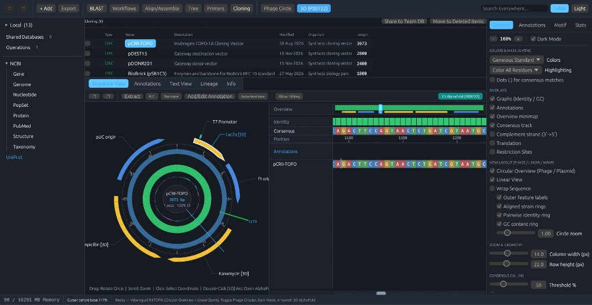
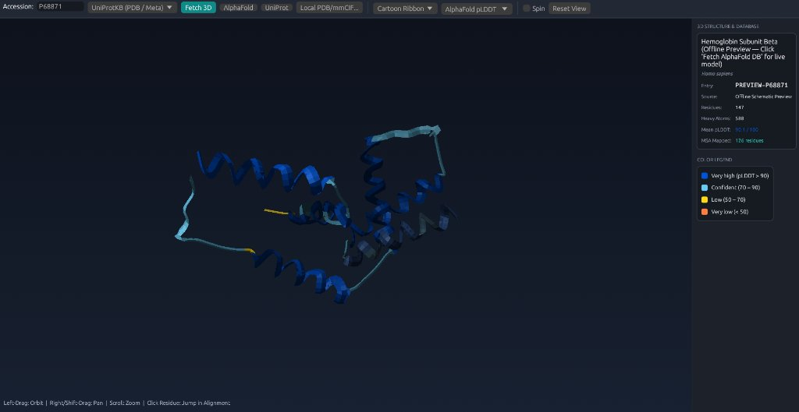

 
An open-source, native Rust bioinformatics, sequence alignment inspection, molecular cloning, and 3D protein visualization suite inspired by **Geneious Prime**, with live **NCBI**, **UniProtKB**, **AlphaFold Protein Structure Database (EBI)**, and **RCSB PDB** integration.

## Preview

### Main Workspace (Dark Mode — Split Circular Plasmid/Phage Overview + Linear Sequence View)


### Separate-Window 3D Protein Viewer (AlphaFold DB & UniProtKB)


## Features

### 1. Sequence Visualization & Editing (`helix-gui`)
- **Multiple View Modes**: Switch or combine **Circular Overview** (plasmid & phage circular maps), **Linear View**, **Split Circular + Linear View**, **Wrapped View**, plus **Annotations**, **Text View**, **Lineage**, **Info**, and **Tree View** tabs.
- **Interactive Sequence & Alignment Canvas** (horizontally virtualized for smooth 60 FPS scrolling):
  - **Overview Minimap Bar**, **Identity % Histogram**, **Consensus Track**, **Coordinate Ruler**, **Packed Directional Annotation Arrows** with `[3D]` badges, **Complement Strand (`3'→5'`)**, **Reading-Frame Translation (`+1`/`+2`/`+3`)**, and **Restriction Sites** (24 built-in Type II enzymes).
  - **Direct Manipulation**: Enable **Allow Editing** to insert/delete bases directly from the keyboard, **Extract** selected regions, generate **Reverse Complements (`R.C.`)**, **Translate** DNA/RNA to Protein documents, and **Auto-Annotate** from built-in **Helix Plasmid Features**.
- **Light & Dark Modern Themes**: Toggle **Dark Mode** / **Light Mode** from the toolbar or General Inspector (synced across both main and 3D windows).
- **Phage Circular Visualization**: Concentric circular genome rings with curved directional annotation arrows, callout labels, aligned strain variant rings, pairwise identity ring, circular GC-content ring, drag-to-rotate, scroll-to-zoom, and bidirectional 3D sync.

### 2. Molecular Biology, Alignment & BLAST Tools (`helix-core`)
- **Multiple Alignment & Mapping Engines**:
  - **De Bruijn Graph Anchor Aligner** (shared k-mer unitig chaining + DP fill)
  - **ClustalW** (weighted guide-tree progressive profile-profile alignment)
  - **Clustal Omega** (mBed k-mer embedding + conservation-weighted profile alignment)
  - **MUSCLE** (3-stage Kimura guide tree + iterative Sum-of-Pairs bipartition refinement)
  - **MAFFT** (physicochemical cross-correlation lag guide tree + iterative refinement)
  - **minimap2** (invokes bundled/system `minimap2` binary with `-a -x <preset>` and SAM CIGAR parsing, with an automatic built-in pure-Rust `(w, k)` minimizer-chaining fallback!)
  - **De Novo Contig Assembly (OLC)** and **Map Reads to Reference**.
- **Multi-Program BLAST Suite**: **`totalBLAST`** (simultaneous nucleotide `+/-` and 6-frame translated protein search across the entire workspace), **`blastn`**, **`blastp`**, **`blastx`**, **`tblastn`**, **`tblastx`**, and **`MegaBLAST`**.
- **In-Silico Cloning & Lineage**: Simulate **Restriction Enzyme Cloning** (single/double digest), **TOPO-TA**, **Gateway (`attB`/`attP`/`attR`)**, and **BioBrick (RFC 10)** assembly with automatic annotation transfer and clickable parent/child **Lineage** provenance.
- **PCR Primers**: Automated Forward/Reverse primer pair designer ($T_m$, GC %, 3' GC clamp, hairpin/self-dimer score) and template binding-site tester.
- **Phylogenetic Trees**: Build **UPGMA** and **Neighbor-Joining** trees (`Jukes-Cantor` / `p-Distance`), inspect interactive phylograms with scale bars, and export **Newick**.

### 3. Separate-Window 3D Protein Viewer (AlphaFold DB & UniProtKB)
- Opens in a **true separate native OS window** (`egui::ViewportId`) with bidirectional residue ↔ alignment-column highlighting.
- **Dual-Source Fetching**: Fetch 3D atomic coordinates and curated metadata from either **AlphaFold DB**, **UniProtKB (experimental RCSB PDB / metadata)**, or **Auto Fallback**, plus local `.pdb` / `.cif` files and an instant offline preview fold.
- **Pure-Rust GPU-Batched 3D Renderer** (zero `unsafe` code):
  - **Styles**: *Cartoon Ribbon* (coiled α-helices, arrowed β-strands, tubular loops), *Backbone Tube*, *C-Alpha Trace*, *Ball & Stick*, and *Spacefill (VDW)*.
  - **Coloring**: *AlphaFold pLDDT*, *Secondary Structure*, *MSA Conservation*, *Rainbow (`N → C`)*, and *Chain / CPK Element*.

### 4. Data Management, Public Databases & Operations
- **Geneious-Style Sources Tree**: `Local` (`Alignments`, `Cloning`, `Contig Assembly`, `Genomes`, `Plasmids`, `Primers`, `Protein Documents`, `Tree Documents`), `Reference Features`, recoverable `Deleted Items`, `Shared Databases`, `Operations`, and **Search Everywhere**.
- **Live Public Database Access**: Built-in **NCBI** search & download (**Gene**, **Genome**, **Nucleotide**, **PopSet**, **Protein**, **PubMed**, **Structure**, **Taxonomy**) and **UniProtKB** search & download with automatic transient DNS/network retries.
- **Workflows & Telemetry**: Chain repeatable analysis pipelines in **Workflows**, track background jobs in **Operations**, and monitor live RAM usage (`MB Memory`) and base cursor position in the status bar.

## Workspace Layout

```
genome-visualizer/
├── Cargo.toml
├── run.ps1                         # Windows release/debug build & launch helper
├── docs/screenshots/               # README preview screenshots
├── sample_data/                    # Sample FASTA, GenBank, and GFF3 files
└── crates/
    ├── helix-core/                 # Bioinformatics engine, aligners, BLAST, cloning, NCBI/UniProt/AlphaFold clients
    └── helix-gui/                  # Native eframe/egui desktop GUI + 3D renderer
```

## Building & Running

Requires Rust 1.84+ (`rustup` stable):

```bash
# Run in release mode (recommended for smoothest 60 FPS 3D interaction)
cargo run --release -p helix-gui

# Run all unit & integration tests
cargo test --workspace

# Run Clippy lints
cargo clippy --workspace --all-targets
```

On Windows, you can also use the included helper script or prebuilt binary:

```powershell
# Optimized release build & launch
.\run.ps1 -Release

# Or launch prebuilt binary directly
.\dist\helix-prime.exe
```
